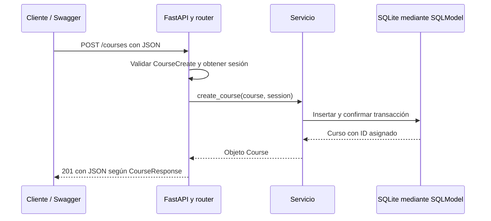

# API Académica: guía para estudiantes

Este proyecto es una API didáctica para registrar y consultar cursos académicos. Permite estudiar cómo una petición HTTP llega a FastAPI, se valida, consulta o modifica una base de datos y produce una respuesta JSON.

La implementación incluye **creación y consulta** de cursos. Todavía no incluye actualización, eliminación, autenticación ni paginación.

## 1. Conceptos básicos y herramientas

Una **API** ofrece operaciones que otros programas pueden utilizar. Un **endpoint** es una combinación de método HTTP y ruta, por ejemplo `GET /courses`. El cliente envía una petición y el servidor devuelve un código de estado y, normalmente, datos en formato **JSON**.

| Herramienta | Función en el proyecto |
| --- | --- |
| FastAPI | Define rutas, coordina la validación y genera documentación interactiva. |
| Uvicorn | Es el servidor ASGI que recibe conexiones HTTP y ejecuta la aplicación. |
| Pydantic | Define y valida los datos que entran y salen de la API. |
| SQLModel | Representa tablas como clases Python y permite consultar los datos. |
| SQLite | Almacena los datos en el archivo local `database.db`. |

Las versiones de las dependencias están fijadas en [requirements.txt](requirements.txt). SQLite no requiere instalar un servidor de base de datos independiente.

## 2. Organización del proyecto

```text
fastapi_academica/
├── main.py                     # Crea FastAPI y registra las rutas
├── requirements.txt            # Dependencias de Python
├── docs.md                     # Esta guía
├── database/
│   └── database.py             # Motor, creación de tablas y sesiones
├── models/
│   └── course.py               # Tabla de cursos
├── schemas/
│   └── course.py               # Datos de entrada y salida
├── routers/
│   └── courses.py              # Endpoints HTTP
├── services/
│   └── course_service.py       # Operaciones sobre los cursos
├── database.db                 # Se genera al iniciar la aplicación
└── venv/                       # Entorno virtual local
```

Los imports parten de estas carpetas: por ejemplo, `from models.course import Course`. No existe una carpeta `app` en esta estructura.

## 3. Instalación y ejecución

El proyecto se ha ejecutado con Python 3.12. Abre una terminal en la carpeta que contiene `main.py`.

### Crear y activar el entorno virtual

Si todavía no tienes un entorno virtual:

```bash
python3 -m venv venv
```

Actívalo en Linux o macOS:

```bash
source venv/bin/activate
```

En Windows PowerShell, puedes crearlo con `python -m venv venv` y activarlo con:

```powershell
.\venv\Scripts\Activate.ps1
```

El entorno virtual mantiene las dependencias del proyecto separadas de las de otros proyectos.

### Instalar las dependencias

Con el entorno activado:

```bash
python -m pip install -r requirements.txt
```

### Iniciar Uvicorn

```bash
python -m uvicorn main:app --reload --host 127.0.0.1 --port 8000
```

- `main` indica el archivo `main.py`.
- `app` identifica el objeto `FastAPI` definido en ese archivo.
- `--reload` reinicia el servidor cuando cambia el código; se usa durante el desarrollo.
- `127.0.0.1` permite acceder desde el mismo equipo.
- `8000` es el puerto donde escucha el servidor.

Mantén esa terminal abierta. Para detener el servidor, presiona `Ctrl+C`.

| Recurso | Dirección |
| --- | --- |
| Documentación interactiva Swagger UI | http://127.0.0.1:8000/docs |
| Especificación OpenAPI | http://127.0.0.1:8000/openapi.json |
| Lista de cursos | http://127.0.0.1:8000/courses |

La ruta `/` no está definida: que responda `404` no significa que el servidor esté fallando.

## 4. Recorrido de una petición



Si los datos de entrada no cumplen el esquema, FastAPI responde con `422` antes de ejecutar el servicio de creación.

## 5. Explicación del código por archivo

### `main.py`: inicio de la aplicación

En [main.py](main.py), `FastAPI(...)` crea la aplicación y `app.include_router(courses_router)` incorpora los endpoints de cursos.

La función `lifespan` administra el ciclo de vida de la aplicación. Antes de `yield` se ejecuta `create_db_and_tables()`, de modo que las tablas estén disponibles antes de recibir peticiones. El código que se agregue después de `yield` se ejecutaría al apagar la aplicación.

Al importar el router, también se importan sus servicios y el modelo `Course`. Así, la tabla queda registrada en los metadatos de SQLModel antes de crearla.

### `database/database.py`: motor y sesiones

En [database/database.py](database/database.py) se define:

```python
DATABASE_URL = "sqlite:///database.db"
```

La ruta es relativa al directorio desde el que ejecutas el servidor. Por eso conviene iniciarlo siempre desde la raíz del proyecto.

El **motor** (`engine`) administra las conexiones. Una **sesión** (`Session`) permite realizar consultas y organizar los cambios de una transacción.

```python
def get_session():
    with Session(engine) as session:
        yield session
```

`yield` entrega la sesión al endpoint. Cuando termina el uso de la dependencia, el bloque `with` cierra la sesión. Cerrar una sesión no equivale a confirmar cambios: para guardarlos se utiliza `commit()`.

La opción `check_same_thread=False` permite usar conexiones SQLite desde distintos hilos. No convierte una sesión en un objeto seguro para compartir simultáneamente; cada petición obtiene su propia sesión.

`SQLModel.metadata.create_all(engine)` crea las tablas que faltan. **No actualiza automáticamente la estructura de tablas existentes** cuando modificas el modelo; ese problema se aborda con migraciones.

### `models/course.py`: representación de la tabla

En [models/course.py](models/course.py), `Course` hereda de `SQLModel` y usa `table=True`, por lo que representa una tabla de la base de datos.

| Campo | Tipo | Significado |
| --- | --- | --- |
| `id` | Entero; puede ser `None` antes de guardar | Clave primaria asignada por SQLite al insertar. |
| `name` | Texto | Nombre del curso. |
| `credits` | Entero | Cantidad de créditos. |
| `active` | Booleano | Estado del curso; por defecto es `True`. |

La clave primaria identifica cada registro. Dos cursos pueden tener el mismo nombre porque el modelo no impone una restricción de unicidad sobre `name`.

### `schemas/course.py`: contratos de entrada y salida

En [schemas/course.py](schemas/course.py) hay dos esquemas Pydantic:

| Esquema | Uso |
| --- | --- |
| `CourseCreate` | Valida los datos enviados para crear un curso. |
| `CourseResponse` | Define los campos devueltos al cliente, incluido `id`. |

`CourseCreate` exige un nombre de entre 3 y 80 caracteres y créditos entre 1 y 6, ambos límites incluidos. `active` es opcional y toma el valor `true` si se omite.

Estas restricciones se declaran en el esquema de entrada; no son restricciones de longitud o rango declaradas en el modelo de tabla. La validación de la API y las restricciones de la base de datos son responsabilidades diferentes.

### `routers/courses.py`: interfaz HTTP

En [routers/courses.py](routers/courses.py), `APIRouter` agrupa las rutas con el prefijo `/courses`. La etiqueta `Courses` las organiza en Swagger.

Los decoradores `@router.get(...)` y `@router.post(...)` vinculan una función con un método y una ruta. `response_model` define la forma de la respuesta, mientras que `status_code=201` indica que se creó un recurso.

`Depends(get_session)` solicita a FastAPI una sesión mediante su sistema de **inyección de dependencias**: el endpoint recibe la sesión sin tener que abrirla y cerrarla por su cuenta.

### `services/course_service.py`: operaciones sobre los cursos

En [services/course_service.py](services/course_service.py) se concentran las operaciones de datos:

- `create_course`: construye un `Course`, lo guarda y devuelve el registro.
- `list_courses`: ejecuta `select(Course)` y reúne los resultados con `.all()`.
- `get_course`: busca por clave primaria con `session.get(Course, course_id)`; si no existe, lanza `HTTPException` con código `404`.

La creación sigue tres pasos distintos:

```python
session.add(course)      # Incorpora el objeto a la sesión.
session.commit()         # Confirma la transacción y guarda los cambios.
session.refresh(course)  # Recarga los valores guardados, incluido el ID.
```

Separar routers y servicios permite leer por un lado el contrato HTTP y, por otro, las operaciones necesarias para cumplirlo.

## 6. Endpoints y ejemplos

Los siguientes comandos usan `curl` con sintaxis de Bash. También puedes enviar las mismas peticiones desde Swagger. Los IDs mostrados son ejemplos: utiliza el ID real que devuelva tu API.

### Crear un curso: `POST /courses`

```bash
curl -i -X POST http://127.0.0.1:8000/courses \
  -H 'Content-Type: application/json' \
  -d '{"name": "Programación I", "credits": 3, "active": true}'
```

`Content-Type` indica que el cuerpo contiene JSON. Una respuesta correcta tiene estado **201 Created** y esta estructura:

```json
{
  "id": 1,
  "name": "Programación I",
  "credits": 3,
  "active": true
}
```

No necesitas enviar `id`: lo genera la base de datos. Cada POST válido crea un registro nuevo, incluso si repites el nombre.

### Listar cursos: `GET /courses`

```bash
curl -i http://127.0.0.1:8000/courses
```

Responde con **200 OK** y una lista:

```json
[
  {
    "id": 1,
    "name": "Programación I",
    "credits": 3,
    "active": true
  }
]
```

Si no hay registros, devuelve `[]`. La consulta incluye cursos activos e inactivos y no establece un orden explícito.

### Consultar un curso: `GET /courses/{course_id}`

```bash
curl -i http://127.0.0.1:8000/courses/1
```

Si existe, responde con **200 OK** y un objeto de curso. Si no existe, responde con **404 Not Found**:

```json
{
  "detail": "Course not found"
}
```

### Probar la validación

Esta petición contiene un nombre demasiado corto y créditos fuera del rango permitido:

```bash
curl -i -X POST http://127.0.0.1:8000/courses \
  -H 'Content-Type: application/json' \
  -d '{"name": "A", "credits": 9}'
```

La respuesta esperada es **422**. El campo `detail` describe los errores y su ubicación. Esta petición no crea un curso. Un identificador no entero, como `/courses/abc`, también produce `422`.

| Estado | Interpretación en este proyecto |
| --- | --- |
| `200` | Consulta realizada correctamente. |
| `201` | Curso creado correctamente. |
| `404` | Curso o ruta inexistente. |
| `422` | La entrada no cumple el esquema esperado. |

## 7. Práctica guiada con Swagger

1. Inicia Uvicorn y abre http://127.0.0.1:8000/docs.
2. Abre `GET /courses`, pulsa **Try it out** y después **Execute**. Observa la lista inicial.
3. Abre `POST /courses` y crea un curso con nombre y créditos válidos. Omite `active` para comprobar su valor predeterminado.
4. Anota el `id` devuelto y consúltalo con `GET /courses/{course_id}`.
5. Envía créditos con valor `0` y observa el error de validación.
6. Crea otro curso con `active: false` y verifica que también aparece en la lista.
7. Detén el servidor y vuelve a iniciarlo desde la misma carpeta. Consulta los cursos para comprobar que SQLite conserva los datos.

Estas operaciones de creación guardan registros reales en el archivo local del proyecto.

## 8. Problemas frecuentes

| Problema | Qué revisar |
| --- | --- |
| `No module named uvicorn` o `fastapi` | Activa el entorno virtual e instala `requirements.txt` con ese mismo Python. |
| No se puede importar `main` | Ejecuta Uvicorn desde la carpeta que contiene `main.py`. |
| El puerto 8000 está ocupado | Revisa si ya hay un servidor activo o inicia con `--port 8001` y ajusta las URLs. |
| El navegador no conecta | Confirma que Uvicorn sigue abierto y revisa host, puerto y mensajes de la terminal. |
| `/` responde con `404` | Abre `/docs` o `/courses`; no hay endpoint para la raíz. |
| Aparece una lista vacía inesperadamente | Comprueba el directorio de ejecución: la ruta de SQLite es relativa. |
| Cambié el modelo, pero la tabla no cambió | `create_all()` no realiza migraciones de tablas existentes. |

## 9. Ejercicios para continuar

Estas propuestas son ampliaciones para practicar; aún no están implementadas:

1. Agregar un endpoint `GET /` con un mensaje de bienvenida.
2. Incorporar un filtro opcional para consultar solo cursos activos.
3. Implementar la actualización de un curso y definir su esquema de entrada.
4. Implementar la eliminación y decidir qué respuesta entregar si el ID no existe.
5. Agregar paginación para limitar cuántos cursos devuelve una consulta.
6. Escribir pruebas para creación válida, datos inválidos y consulta de un ID inexistente, usando una base de datos separada para pruebas.

Antes de programar cada ejercicio, identifica qué archivos deberían cambiar y qué respuesta HTTP esperas. Esto ayuda a relacionar la estructura del proyecto con el comportamiento observable de la API.
