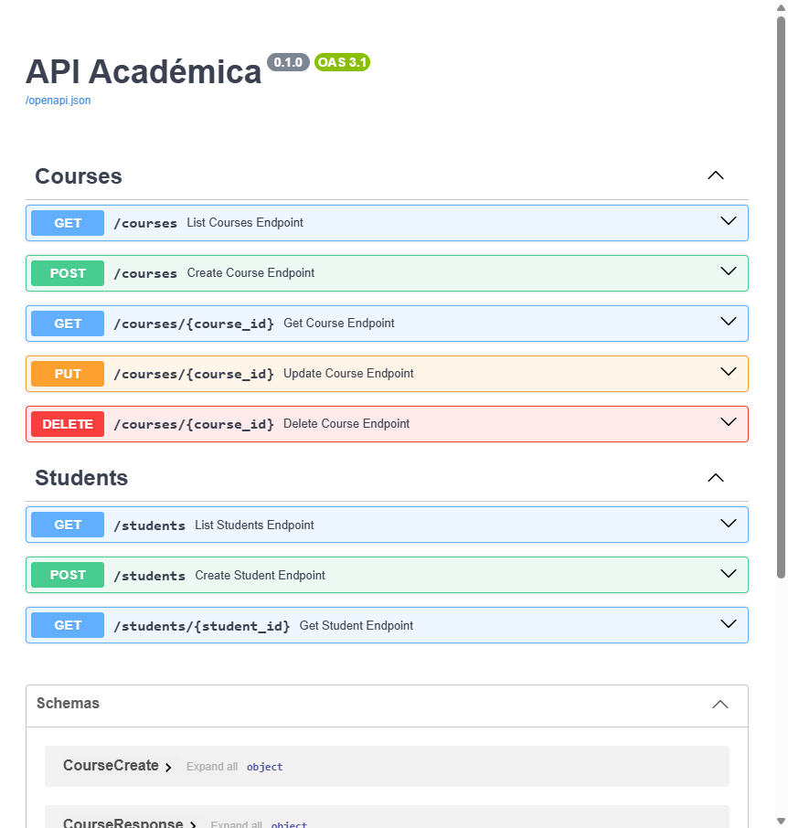
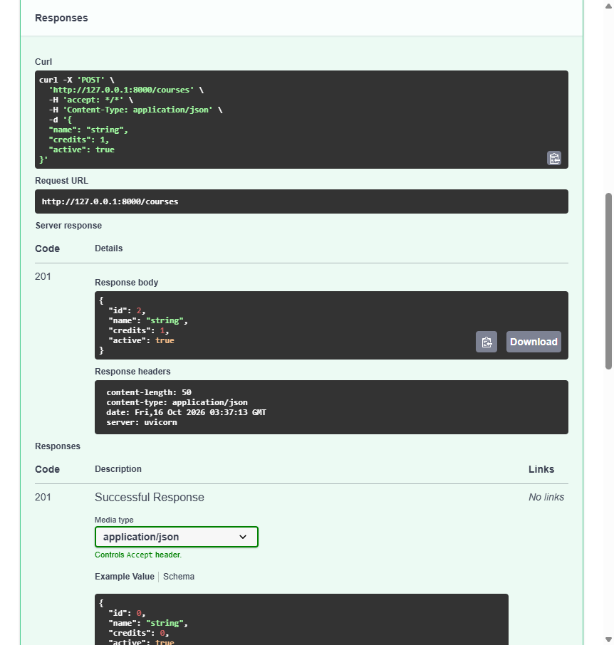
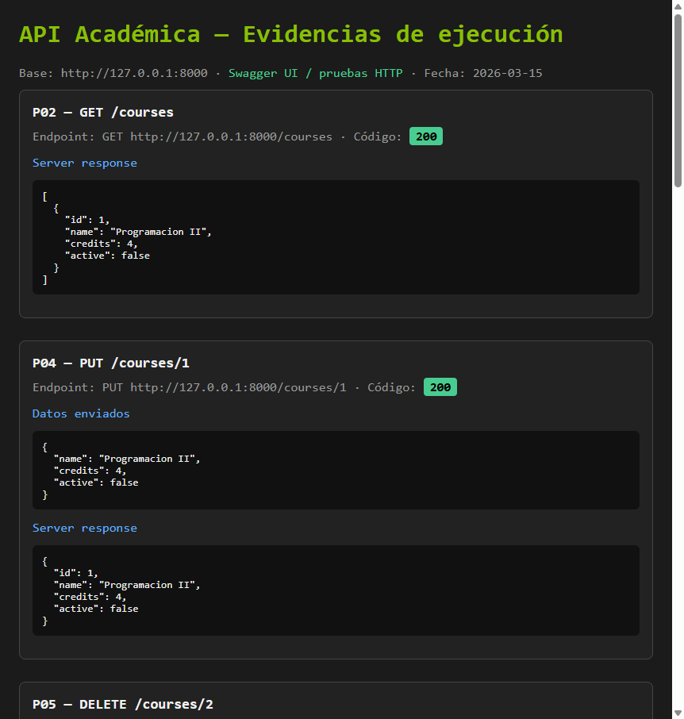
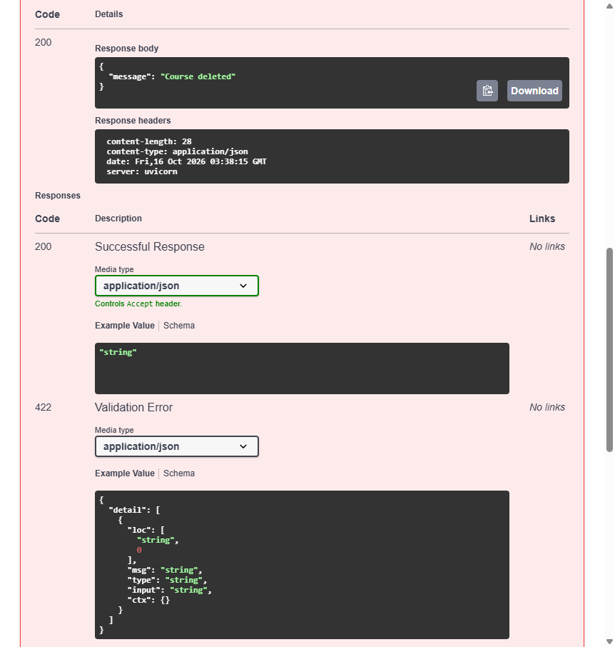
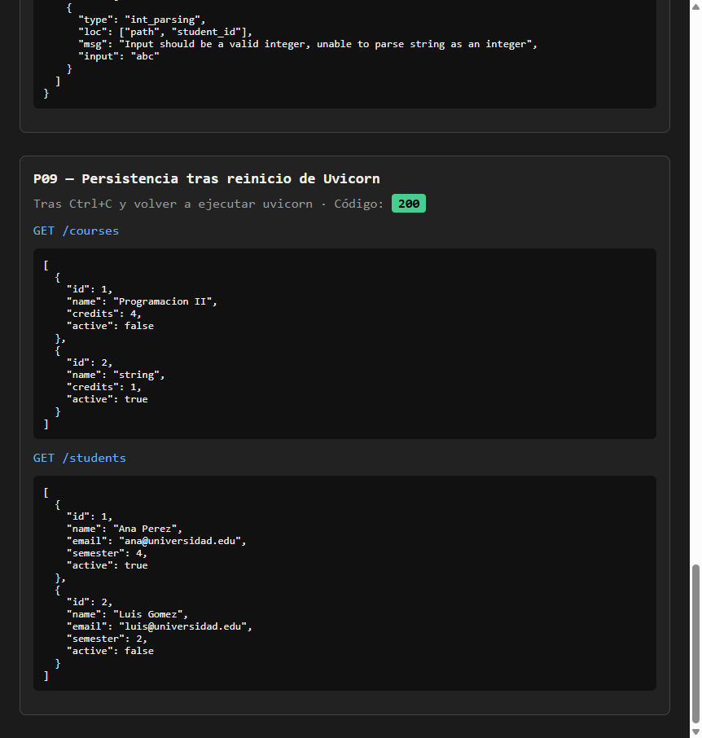

# Informe de pruebas — API Académica

| Campo | Valor |
| --- | --- |
| Estudiante | Juan Corzo |
| Fecha | 2026-10-15 |
| Proyecto | API Académica (FastAPI + SQLModel + SQLite) |
| Comando de inicio | `python -m uvicorn main:app --reload --host 127.0.0.1 --port 8000` |
| URL base | http://127.0.0.1:8000 |
| Documentación | http://127.0.0.1:8000/docs |
| Herramienta | Swagger UI y pruebas HTTP contra la API en ejecución |
| Estado inicial | Base local `database.db` con tablas `course` y `student` |

## Resumen de resultados

| Caso | Endpoint | HTTP | Estado |
| --- | --- | --- | --- |
| P00 | Swagger overview | — | APROBADO |
| P01 | POST /courses | 201 | APROBADO |
| P01b | POST /courses (segundo curso) | 201 | APROBADO |
| P02 | GET /courses | 200 | APROBADO |
| P03 | GET /courses/{id} | 200 | APROBADO |
| P04 | PUT /courses/{id} | 200 | APROBADO |
| P04b | PUT credits=0 | 422 | APROBADO |
| P04c | PUT credits=7 | 422 | APROBADO |
| P04d | PUT name corto | 422 | APROBADO |
| P04e | PUT sin active | 422 | APROBADO |
| P04f | PUT id inexistente | 404 | APROBADO |
| P05 | DELETE /courses/{id} | 200 | APROBADO |
| P05b | GET curso eliminado | 404 | APROBADO |
| P05c | DELETE mismo id otra vez | 404 | APROBADO |
| P05d | DELETE /courses/abc | 422 | APROBADO |
| P06 | POST /students (sin active) | 201 | APROBADO |
| P06b | POST /students active=false | 201 | APROBADO |
| P07 | GET /students | 200 | APROBADO |
| P08 | GET /students/{id} | 200 | APROBADO |
| P08b | GET estudiante inexistente | 404 | APROBADO |
| P08c | GET /students/abc | 422 | APROBADO |
| P08d | POST semester=0 | 422 | APROBADO |
| P08e | POST semester=11 | 422 | APROBADO |
| P08f | POST name corto | 422 | APROBADO |
| P08g | POST email vacío | 422 | APROBADO |
| P09 | Persistencia tras reinicio | 200 | APROBADO |

**Total ejecutado en batería automatizada:** 24 casos · **Fallidos:** 0

## Evidencias disponibles

| Archivo | Casos que soporta |
| --- | --- |
| [evidencias/P00-swagger-overview.png](evidencias/P00-swagger-overview.png) | P00 — rutas Courses y Students en Swagger |
| [evidencias/P01-crear-curso-201.png](evidencias/P01-crear-curso-201.png) | P01 — POST /courses con Server response 201 |
| [evidencias/P02-listar-y-put.png](evidencias/P02-listar-y-put.png) | P02, P04 — listado y actualización |
| [evidencias/P04-put-actualizar-200.png](evidencias/P04-put-actualizar-200.png) | P04 — PUT en Swagger |
| [evidencias/P05-delete-200.png](evidencias/P05-delete-200.png) | P05 — DELETE con `{"message":"Course deleted"}` |
| [evidencias/P09-persistencia-reinicio.png](evidencias/P09-persistencia-reinicio.png) | P08c, P09 — 422 por id no entero y datos tras reinicio |

---

## Fichas de prueba

### Caso: P00

**Endpoint:** Swagger UI — http://127.0.0.1:8000/docs

**Datos enviados:** N/A

**Resultado esperado:** Aparecen secciones Courses (POST, GET, GET by id, PUT, DELETE) y Students (POST, GET, GET by id).

**Resultado obtenido:** Swagger muestra ambas secciones y los ocho endpoints.

**Código HTTP:** N/A

**Estado:** APROBADO

**Evidencia:** 

---

### Caso: P01

**Endpoint:** `POST /courses`

**Datos enviados:**

```json
{
  "name": "Desarrollo Web II",
  "credits": 3,
  "active": true
}
```

**Resultado esperado:** 201 Created y curso con ID generado.

**Resultado obtenido:** 201 Created. Ejemplo: `{"id":1,"name":"Desarrollo Web II","credits":3,"active":true}`

**Código HTTP:** 201

**Estado:** APROBADO

**Evidencia:** 

---

### Caso: P02

**Endpoint:** `GET /courses`

**Datos enviados:** N/A

**Resultado esperado:** 200 y lista de cursos.

**Resultado obtenido:** 200 con arreglo JSON de cursos.

**Código HTTP:** 200

**Estado:** APROBADO

**Evidencia:** 

---

### Caso: P03

**Endpoint:** `GET /courses/1`

**Datos enviados:** path `course_id=1`

**Resultado esperado:** 200 con el curso solicitado.

**Resultado obtenido:** 200 con los datos del curso.

**Código HTTP:** 200

**Estado:** APROBADO

**Evidencia:** Cubierto por la batería HTTP y el listado en P02.

---

### Caso: P04

**Endpoint:** `PUT /courses/1`

**Datos enviados:**

```json
{
  "name": "Programacion II",
  "credits": 4,
  "active": false
}
```

**Resultado esperado:** 200, mismo ID, valores actualizados; no se crea un curso nuevo.

**Resultado obtenido:** 200 con `id` 1, `active: false`, créditos 4.

**Código HTTP:** 200

**Estado:** APROBADO

**Evidencia:** 

---

### Caso: P04b / P04c / P04d / P04e

**Endpoint:** `PUT /courses/1`

| Subcaso | Datos | Esperado | Obtenido | Estado |
| --- | --- | --- | --- | --- |
| P04b | credits=0 | 422 | 422 | APROBADO |
| P04c | credits=7 | 422 | 422 | APROBADO |
| P04d | name="AB" | 422 | 422 | APROBADO |
| P04e | sin campo active | 422 | 422 (`Field required`) | APROBADO |

**Estado:** APROBADO

---

### Caso: P04f

**Endpoint:** `PUT /courses/99999`

**Datos enviados:** cuerpo válido de actualización.

**Resultado esperado:** 404 `{"detail":"Course not found"}`

**Resultado obtenido:** 404 con ese detalle.

**Código HTTP:** 404

**Estado:** APROBADO

---

### Caso: P05

**Endpoint:** `DELETE /courses/2` (o el ID creado para la prueba)

**Datos enviados:** path integer

**Resultado esperado:** 200 y `{"message":"Course deleted"}`

**Resultado obtenido:** 200 con ese mensaje.

**Código HTTP:** 200

**Estado:** APROBADO

**Evidencia:** 

---

### Caso: P05b / P05c / P05d

| Subcaso | Endpoint | Esperado | Obtenido | Estado |
| --- | --- | --- | --- | --- |
| P05b | GET curso eliminado | 404 | 404 | APROBADO |
| P05c | DELETE mismo ID | 404 | 404 | APROBADO |
| P05d | DELETE /courses/abc | 422 | 422 | APROBADO |

---

### Caso: P06

**Endpoint:** `POST /students`

**Datos enviados:**

```json
{
  "name": "Ana Perez",
  "email": "ana@universidad.edu",
  "semester": 4
}
```

**Resultado esperado:** 201, ID generado, `active: true` por defecto.

**Resultado obtenido:** 201 con `active: true`.

**Código HTTP:** 201

**Estado:** APROBADO

---

### Caso: P06b

**Endpoint:** `POST /students`

**Datos enviados:** incluye `"active": false`

**Resultado esperado:** 201 y `active: false` conservado.

**Resultado obtenido:** 201 con `active: false`.

**Código HTTP:** 201

**Estado:** APROBADO

---

### Caso: P07 / P08

| Caso | Endpoint | Esperado | Obtenido | Estado |
| --- | --- | --- | --- | --- |
| P07 | GET /students | 200 lista | 200 lista | APROBADO |
| P08 | GET /students/1 | 200 objeto | 200 objeto | APROBADO |

---

### Caso: P08b

**Endpoint:** `GET /students/99999`

**Resultado esperado:** 404 `{"detail":"Student not found"}`

**Resultado obtenido:** 404 con ese detalle.

**Código HTTP:** 404

**Estado:** APROBADO

---

### Caso: P08c / P08d / P08e / P08f / P08g

| Subcaso | Situación | Esperado | Obtenido | Estado |
| --- | --- | --- | --- | --- |
| P08c | /students/abc | 422 | 422 | APROBADO |
| P08d | semester=0 | 422 | 422 | APROBADO |
| P08e | semester=11 | 422 | 422 | APROBADO |
| P08f | name de 2 caracteres | 422 | 422 | APROBADO |
| P08g | email vacío | 422 | 422 | APROBADO |

**Evidencia P08c:** 

---

### Caso: P09 — Persistencia

**Procedimiento:**

1. Crear/actualizar cursos y estudiantes.
2. Detener Uvicorn (`Ctrl+C`).
3. Volver a ejecutar `python -m uvicorn main:app --host 127.0.0.1 --port 8000`.
4. Consultar nuevamente.

**Resultado esperado:** Los registros persisten en SQLite; el curso actualizado conserva valores; los eliminados no reaparecen.

**Resultado obtenido:** Tras el reinicio, `GET /courses` devolvió el curso `id=1` con `name=Programacion II`, `credits=4`, `active=false`. `GET /students` devolvió a Ana Pérez y Luis Gómez. Los datos no viven solo en memoria.

**Código HTTP:** 200

**Estado:** APROBADO

**Evidencia:** 

---

## Observaciones

- Un código HTTP de error esperado (404 o 422) se considera **APROBADO**.
- Courses y Students comparten el mismo archivo `database.db` con tablas distintas.
- La lógica de negocio permanece en `services/`; los routers solo exponen HTTP.
